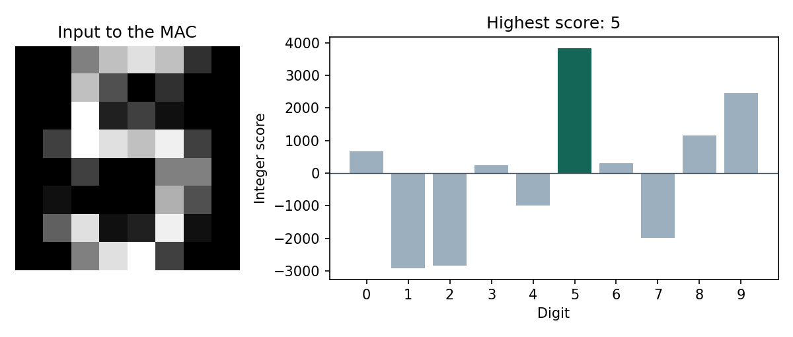
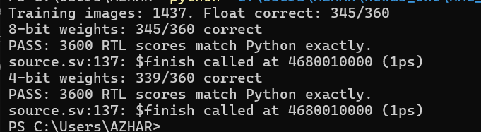
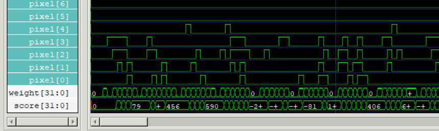
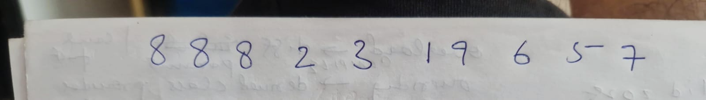
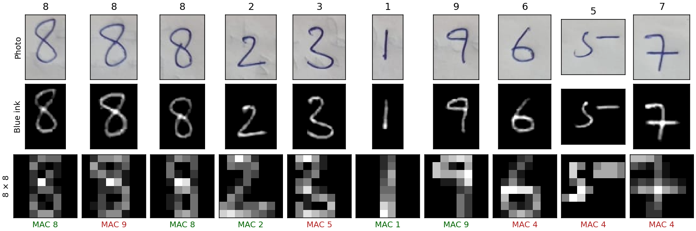
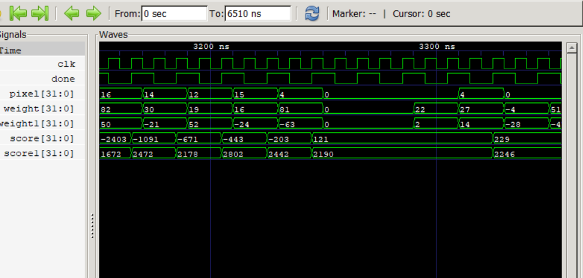
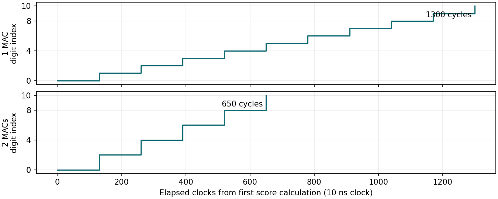

# Handwritten digit classification on a Verilog MAC

One 8×8 image goes in. Ten integer scores come out, one per possible digit. The highest score is the prediction. This experiment uses the same [MAC core](../rtl/mac_core.sv) as the four-axis PID example. With two instances, the classifier calculates two scores at once and finishes one image in **650 clocks**, compared with **1,300 clocks** on one instance.

## 1. Test pictures and reference answers

- The training and benchmark pictures are actual handwritten digits from [scikit-learn's copy of the UCI optical recognition dataset](https://scikit-learn.org/stable/modules/generated/sklearn.datasets.load_digits.html). Each is an 8×8 grid of pixel values from 0 to 16.
- [Python](run_classifier.py) fits a linear classifier on 1,437 images and holds out 360 for testing. The split is stratified by digit with random seed 42. Each class learns 64 weights and one bias.
- For the integer tests, Python scales the learned weights and rounds them to signed 8-bit or 4-bit values. It scales the biases by the same factor. The RTL interface and accumulator stay 32 bits in both runs.
- Python writes temporary pixel, weight, bias, and expected-score files. The [SystemVerilog testbench](tb_classifier.sv) loads them, drives the MAC, and checks every returned score. Each hardware result is compared against the integer Python model at the same precision. The float model provides the accuracy baseline.



## 2. One MAC, one score at a time

1. Load the bias for digit 0 into the accumulator.
2. For each of the 64 pixels, send the pixel and its corresponding weight. The MAC computes `score = score + pixel × weight`.
3. Check the final score against Python. Repeat for digits 1 through 9.



| Weight precision | Correct digit predictions | Exact RTL score matches per design |
|---|---:|---:|
| Floating-point Python | 345 / 360 | — |
| 8-bit | 345 / 360 | 3,600 / 3,600 |
| 4-bit | 339 / 360 | 3,600 / 3,600 |

There are 3,600 comparisons because every image has ten scores. A score can match Python exactly and still lead to an incorrect digit prediction.



Read the waveform from left to right. The expanded pixel rows are bits of one pixel. The weight row gives its multiplier. The score row is the running total, which updates when the command completes.

## 3. Pen-on-paper test

This separate test uses one handwritten photo. The ten digits were manually cropped for the experiment. The demo itself accepts one digit per file.





To reproduce the preprocessing, the crops use rows 72–174 and these horizontal intervals (left inclusive, right exclusive): `325–389, 416–490, 520–591, 649–730, 778–861, 950–999, 1002–1074, 1143–1226, 1260–1378, 1390–1479`. Blue ink intensity is `clip((blue - red - 7) × 7, 0, 255)`, calculated with signed integers. The [ten saved ink crops](assets/handwriting/) are the image files passed into [the digit loader](digit_demo.py). It adjusts contrast, crops to the strokes, fits the digit into an 8×8 frame while preserving its proportions, and scales brightness to 0–16.

| Left-to-right position | 1 | 2 | 3 | 4 | 5 | 6 | 7 | 8 | 9 | 10 |
|---|---:|---:|---:|---:|---:|---:|---:|---:|---:|---:|
| Written digit | 8 | 8 | 8 | 2 | 3 | 1 | 9 | 6 | 5 | 7 |
| Floating-point Python | 8 | 9 | 8 | 2 | 5 | 1 | 9 | 4 | 7 | 4 |
| 8-bit RTL | 8 | 9 | 8 | 2 | 5 | 1 | 9 | 4 | 4 | 4 |

Both versions recognised **5 of the 10**. The second 8 was read as 9. At position 9 the written 5 was read as 7 by the float model and 4 after quantisation. The RTL matched **all 100 integer Python scores**. This photo tests one person's handwriting and the crop-to-8×8 pipeline. It is a separate result from the 360-image benchmark.

## 4. Two MACs in parallel

[dual_mac.sv](../rtl/dual_mac.sv) instantiates two copies of the same core. Both receive the same pixel. Each receives its own weight and bias and maintains its own accumulator. The testbench schedules pairs 0/1, 2/3, 4/5, 6/7, and 8/9.



One update is visible about halfway across the screenshot. The shared pixel is **4**. Follow the weights through to the next completed scores:

| Lane | Previous score | Pixel × weight | New score visible in GTKWave |
|---|---:|---:|---:|
| 0 | −203 | 4 × 81 | **121** |
| 1 | 2,442 | 4 × (−63) | **2,190** |

Next the pixel goes to zero and both scores hold. When the pixel becomes 4 again, the weights are 27 and 14. The scores become **229** and **2,246**. These are intermediate totals.

## 5. How much time does the second MAC save?



Each score takes one bias load plus 64 multiply–accumulate commands. The tested interface takes two clocks per command. This gives 130 clocks per score. One lane needs ten rounds; two lanes need five. In the plot the dual-lane index identifies the first digit of each pair. Index 10 is the loop exit.

| Measured result | One MAC | Two MACs |
|---|---:|---:|
| Simulated clocks per image | 1,300 | 650 |
| Simulated clocks for 360 images | 468,000 | 234,000 |
| Score time at 100 MHz | 13 µs | 6.5 µs |
| DSP blocks | 3 | 6 |
| Slice LUTs | 82 | 163 |
| Slice registers | 85 | 169 |

Both designs passed all score checks at both precisions. Vivado placed and routed the standalone datapaths for the Zynq-7020 (`xc7z020clg400-1`) under a 10 ns clock constraint. Both met the internal timing target. The **2× improvement** is for score computation when the testbench supplies pixels and weights on time. The benchmark excludes image preprocessing, memory stalls, choosing the winning digit, and board I/O. Python runtime was not benchmarked. [Simulation log and Vivado reports](assets/benchmark-reports.zip)

## Run it

Install Python, scikit-learn, and Icarus Verilog with `iverilog` and `vvp` on PATH. The image demo also uses Pillow and Matplotlib. From this classifier directory:

```sh
python -m pip install scikit-learn pillow matplotlib
python run_classifier.py
```

The default run trains once and compares both lane counts against the same scores. To replay the second handwritten 8 with two MACs:

```sh
python run_classifier.py --demo assets/handwriting/ink-02.png --demo-lanes 2
```

The demo writes `digit_result.png` and `digit.vcd` in the current directory. Open the VCD in GTKWave and display `clk`, `done`, `pixel`, `weight`, `weight1`, `score`, and `score1`. Signed decimal makes the arithmetic easiest to follow.

[Download both recorded waveforms and GTKWave layouts](assets/waveforms.zip).
