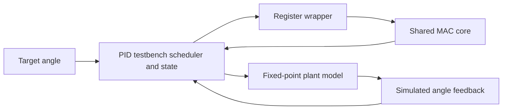

# KINETIC-S

## Shared MAC acceleration for PID control

KINETIC-S explores how a reusable hardware multiply-accumulate (MAC) unit can support fixed-point PID workloads. The current deliverable is a parameterized MAC core, a register and streaming wrapper, and simulation testbenches that exercise the core with both basic arithmetic and PID-style control workloads.

The hinged propeller-arm example is a Verilog simulation. Its testbench supplies the target, maintains PID history, sends commands to the MAC, and updates a simplified plant model. It demonstrates the data path and closed-loop simulation flow; it is not a measurement from a physical IMU, motor, propeller, or FPGA board.

## Why use a shared MAC

A PID controller repeatedly multiplies values by gains and accumulates the results:

```text
u[n] = Kp * e[n] + Ki * integral[n] + Kd * derivative[n]
```

There are two common hardware approaches:

| Approach | How it works | Main trade-off |
|---|---|---|
| Parallel gate-level PID datapath | Build separate multipliers and adders for the P, I, and D paths, often repeating that hardware for each axis. | Low latency and parallel updates, at the cost of more arithmetic hardware, routing, and switching activity as axes are added. |
| Shared MAC | Reuse one multiplier and accumulator for successive products and control axes. Keep PID history and scheduling in the controller. | Less duplicated arithmetic hardware, with more sequential commands and a longer update schedule. |

A MAC is itself digital logic. The comparison is between duplicated parallel arithmetic and a shared arithmetic unit, not between a MAC and “no gates.”

For intuition, a simple CPU implementation without a fused MAC instruction may need several instructions to prepare operands, multiply, add to the accumulator, and write back the result. A sequence of roughly six steps is a useful example, but the exact count depends on the CPU, instruction set, compiler, and register allocation. One MAC command expresses `accumulator + a * b` as a single hardware operation. In this RTL, the result commits one clock interval after command acceptance; a complete PID update still takes multiple commands and controller steps.

The current repository does not contain a RISC-V CPU or a measured CPU-versus-MAC benchmark. The testbench's “fake CPU” is simulation code that performs the scheduling role a future processor could perform.

## Architecture



The PID testbench computes the angle error and retains the historical P, I, D, and error values outside the MAC. It sends multiply-accumulate commands through the register wrapper, combines the returned terms, clamps the simulated control output, and feeds that output to the plant model. The next simulated angle becomes the following sample's feedback.

### Simulation process

1. Set the target angle and initial simulated angle.
2. Compute the error between target and feedback.
3. Use the shared MAC for the proportional, integral, and derivative products.
4. Update PID history and combine/clamp the control output in the testbench.
5. Apply the output to the fixed-point plant model and calculate the next angle.
6. Repeat until the settling condition is met or the sample limit is reached.

The example plant uses integer shifts to scale the thrust effect and a restoring term. Its angle and thrust values are simulation units; the supplied files do not define a calibration to degrees, newtons, or a physical actuator.

## Demonstration results

The supplied propeller-arm simulation log uses a target angle of `450` and an initial angle of `0`.

| Measurement | Reported result |
|---|---:|
| Logical samples processed | 106 |
| Total simulation clock cycles | 6,365 |
| Cycles measured around the three bus-driven MAC calls | 6,360 total, or 60 per sample |
| Settling shown in the log | Angle reaches 450 at sample 88; the displayed error is 0 in the following samples |
| Basic MAC sequence | All 8 steps pass in the supplied testbench output |

The 60-cycle figure is the testbench's end-to-end schedule for the P/I/D register transactions and result polling. It is not the arithmetic latency of one MAC command. The core itself commits a command one clock interval after accepting it.

The broader standalone-core regression documented with the project also reports 88,000 axis samples matching the original PID RTL. See the [MAC core README](mac_core/README.md) for the register map, arithmetic modes, command timing, and regression details.

## Output media

Place the supplied screenshots and plots in a repository-level `media/` directory with these names, or update the paths below to match your filenames:

### PID control waveform


### Propeller-arm response


### Simulation summary


## Repository scope

| Included in the current work | Future integration, not part of the current core |
|---|---|
| Parameterized MAC RTL and local register/stream wrapper | RISC-V soft-core processor and firmware driver |
| Basic arithmetic and wrapper testbenches | AXI-Lite bridge, DMA, UART, and SPI integration |
| PID arithmetic comparison and simplified plant simulation | Physical IMU, motor, and propeller feedback loop |
| Golden-output checks against the original PID RTL | Verified FPGA resource, power, or post-route timing results |

The repository is a useful starting point for hardware/software partitioning: the MAC handles repeated multiply-accumulate work, while a future CPU can own setpoints, sensor processing, PID state, scheduling, and actuator policy.

## Run the standalone MAC regression

The self-contained core regression is in [`mac_core/`](mac_core/README.md). It uses Python 3 and Icarus Verilog (`iverilog` and `vvp`):

```sh
cd mac_core
python scripts/run.py
```

See the core README for the tested configurations, interface contract, and Windows-specific simulator notes.
